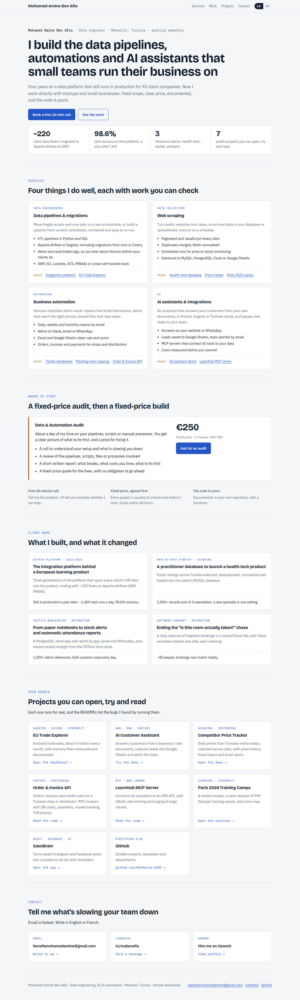

<div align="center">

# 🧭 Mohamed Amine Ben Afia · Portfolio

**Data pipelines, web scraping, business automation and AI assistants, for startups and small businesses.**

  



</div>

## ✨ What's inside

| Page | What it shows |
|---|---|
| `/` | Services, the fixed-price audit, client work, open-source projects, contact |
| `/work/integration-platform` | 4 years on a multi-tenant integration platform (Airflow on AWS MWAA) |
| `/work/practitioner-database` | Scraping + cleaning practitioner listings for a health-tech startup |
| `/work/textile-stock-attendance` | Stock app with alerts + ZKTeco attendance reports for a textile wholesaler |
| `/work/meeting-rooms` | Daily cleanup of forgotten room bookings + Slack reminders |

## 🛠️ How it works

- Plain HTML and CSS, no framework. Pages are generated by small Python scripts (`build_*.py`) so English and French stay side by side in one place.
- Both languages ship in every page; `assets/lang.js` picks one from `?lang=`, the saved choice, or the browser language.
- Light and dark themes follow the visitor's system setting.

<details>
<summary>Build and preview</summary>

```bash
python3 build.py            # writes site/
npx serve site              # preview at http://localhost:3000
```

Deploys on Vercel with `vercel.json` (`outputDirectory: site`, clean URLs).
</details>

---

<div align="center">Made with ☕ by <a href="https://github.com/MedAmine-SUDO">MedAmine-SUDO</a></div>
